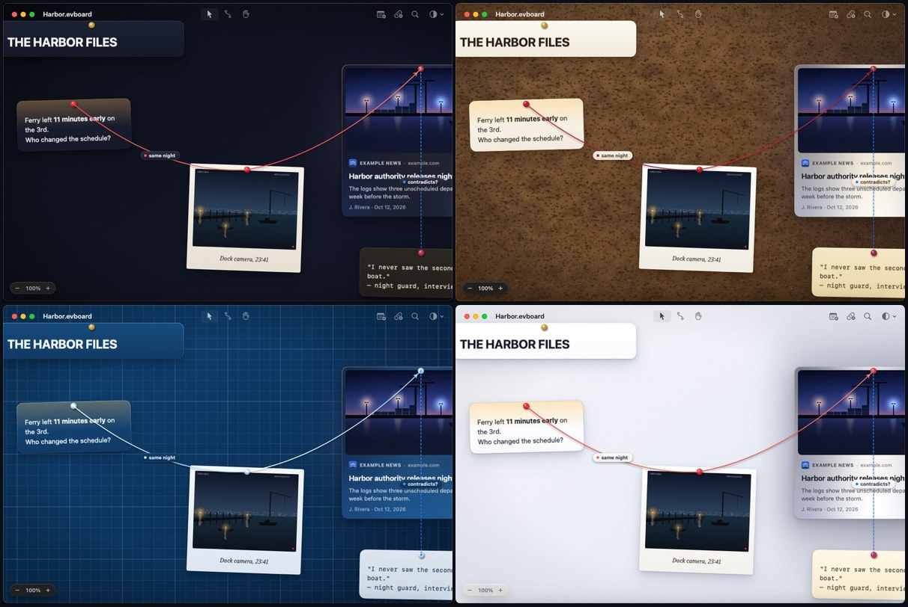
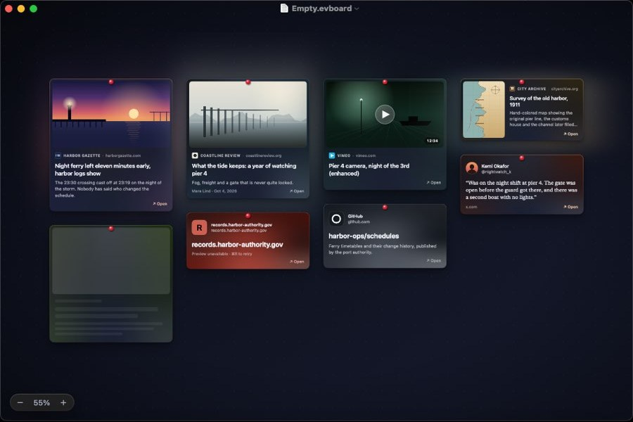

# Evidence Board

A native macOS app for building detective-style evidence boards. You place **text**, **images** and **webpages** on an infinite free canvas and connect the dots with red string. Each board is saved as a single, portable **JSON** file.

- 📐 **Full design document:** [`docs/DESIGN.md`](docs/DESIGN.md)
- 🧾 **File format schema:** [`docs/schema/evidenceboard.schema.json`](docs/schema/evidenceboard.schema.json)
- 🗂 **Sample board:** [`docs/examples/harbor-case.evboard`](docs/examples/harbor-case.evboard)



## Highlights

- A free, infinite canvas that stays at 120 fps (Core Animation engine, culling, level of detail)
- Only three card types: Text, Image and Web
- Rich, gradient-driven link previews built from each page's own color palette
- Physical-looking strings with sag, labels, and **Focus** and **Trace** modes to follow connections
- Four themes: Noir (default), Cork, Blueprint and Daylight, with Liquid Glass on macOS 26
- `.evboard` is plain JSON. Images and link snapshots are embedded, so a board opens offline exactly as you saved it

Built with Swift 6, SwiftUI, AppKit and Core Animation in Xcode, targeting macOS 15 and later.

## Build and run

Requires **Xcode 16 or later** on **macOS 15 or later**.

1. Open `EvidenceBoard.xcodeproj`.
2. Pick the **EvidenceBoard** scheme and press **⌘R**. It signs to run locally, so no developer team is needed.
3. Press **⌘U** to run the BoardKit, LinkPreviewKit and CanvasKit tests.

To try a full board, open `docs/examples/harbor-case.evboard` with **File ▸ Open**.

From the command line:

```sh
swift test --package-path Packages/BoardKit       # also runs on Linux
swift test --package-path Packages/LinkPreviewKit  # also runs on Linux
swift test --package-path Packages/CanvasKit
xcodebuild -project EvidenceBoard.xcodeproj -scheme EvidenceBoard build

# Performance budgets (release build) and the loader fuzzer (Linux)
EB_PERF=1 swift test -c release -Xswiftc -enable-testing --package-path Packages/CanvasKit --filter PerformanceTests
Tools/Fuzz/run.sh 60
```

### Without a Mac

GitHub Actions builds and tests everything on every push (`.github/workflows/ci.yml`). To see the running app, push a commit whose message contains `[snapshot]` (or run the **Snapshot** workflow by hand). It launches the app on a macOS runner with an empty board and the sample board, and publishes screenshots that `Tools/fetch-snapshots.py <commit-sha> <dir>` downloads.

## Project layout

```
EvidenceBoard.xcodeproj    App project (the EvidenceBoard folder is synced, so new files are picked up automatically)
EvidenceBoard/             App target: SwiftUI app, document, window, HUD, theme, assets
Config/                    Info.plist (document types) and sandbox entitlements
Packages/BoardKit/         Model, JSON codec, validation, BoardStore. Foundation only
Packages/CanvasKit/        Camera and the Core Animation canvas (AppKit)
Packages/LinkPreviewKit/   Link previews: fetch, head parser, merger, palette, cache
QuickLook/                 Finder thumbnail and Quick Look preview extensions
docs/                      Design document, JSON schema, sample board
boards/                    Finished boards (open with the app)
Tools/                     Helper scripts; Tools/Boards builds the boards in boards/
```

## Boards

**`boards/The Albania Files.evboard`**: Jared Kushner, Ivanka and Donald Trump; the Sazan Island and Zvërnec resort in Albania; the 2026 "Flamingo Revolution" protests; the claims of an Israeli role, each traced to its source with a verdict; Affinity Partners' billion-dollar deals; envoy Steve Witkoff (Gaza and Moscow with Kushner, World Liberty Financial, Qatar's purchase of his hotel; no link to the Albania project found); and Elon Musk (his 2023 meeting with Rama, his post on the Albania migrant centres, SpaceX and Starlink in Albania, the Gulf funds he shares with Kushner and Witkoff; no link to the resort found). Built from public reporting up to 16 Oct 2026. Every card names its source and is marked ✅ reported, ⚠️ disputed or ❌ no evidence. The map is a schematic drawn for the board.

Its 30 link cards carry the headline and outlet, but no page images. To fetch the real previews, open the board and choose **Board ▸ Refresh All Previews** (⇧⌘R). To rebuild it, run `python3 Tools/Boards/make_map.py map.jpg` and `python3 Tools/Boards/make_board.py map.jpg out.evboard` (Pillow and NumPy). The layout step moves cards so strings and their labels stay off the text, and `Tools/Boards/check.py` reports any that don't.

## Status

**M0 (skeleton)** through **M5 (design polish)** and **M6 (hardening)** are done.

**Hardening (M6)**
- **Performance budgets in CI:** every push runs a release-build suite that drives a real canvas and checks the design's budgets: pan and zoom on 500 and 3,000-card boards, dragging 50 cards with 200 strings, opening and saving a 50 MB board, memory at rest, and nothing running when idle. The run summary has the table; the numbers are in [`docs/DESIGN.md` §11](docs/DESIGN.md#11-performance-budgets).
- **Faster big boards:** card text is drawn in small slices that give way to panning and zooming, strings re-route cheaply while you drag, and saving a 50 MB board takes about 50 ms (image data is written straight into the file).
- **Launch:** not within budget on CI. A release build reaches its first board frame in 345–700 ms on GitHub's virtual Macs (budget 400 ms on an M1 Air), and the app's own code is under 60 ms of that; the rest is the system and SwiftUI. The snapshot run's summary breaks it down. It needs measuring on a real Mac.
- **VoiceOver and keyboard:** every card and string is spoken with its content, tint, lock and connections, with actions (Edit, Open in Browser, Peek, Connect, Focus, Lock, Delete) and a **Connections** rotor. **Tab** walks the cards top to bottom, **⌥ + arrows** jump to the nearest card that way, and **⌘K** with one card selected ties it to the previous one.
- **Increase Contrast and Reduce Transparency** are honored, and a test checks every theme's text against WCAG AA.
- **Fuzzing:** the loader is fuzzed with libFuzzer in CI and by a seeded mutation test. It now caps text lengths and repairs impossible numbers, so whatever loads can always be saved.
- **Quick Look:** Finder shows boards as thumbnails, and Space previews the whole board, drawn without opening the app or touching the network.

**Design polish (M5)**
- **Four themes:** Noir, Cork (procedural cork grain, paper cards, red wool), Blueprint (drafting grid, blue glass cards, white thread) and Daylight. **Automatic** (the default for new boards) follows Dark Mode. Switch with **Board ▸ Theme**, the toolbar's ◐ menu or **⌥⌘T**; the board cross-fades, the theme is saved in the file, and it can be undone.
- **Search (⌘F):** finds cards by text, captions, link titles, sites and addresses. Matches glow, the rest dims, **↩** or **⌘G** steps through them. **Esc** closes it.
- **Minimap:** bottom right, while you pan or zoom (or always, from the View menu). Click or drag in it to move there.
- **Toolbar:** Select, Connect and Hand tools (**V**, **C**, **H**), New Text Card, Add Link, Search and Theme.
- **Motion:** cards spring in and settle when dropped, previews cross-fade in, photos fade in. Reduce Motion turns it all into short fades.
- **Glass:** HUDs, banners, search and minimap use Liquid Glass on macOS 26 and a frosted material before that.

**Web cards (M4)**



- **Add:** paste a link, drag one from a browser, drop a `.webloc` file, or use **Insert ▸ Link…** (⌘L). The card appears at once as a shimmering skeleton while the preview loads.
- **Previews:** the app reads the page's `<head>` (Open Graph, Twitter cards, JSON‑LD, icons) alongside the system's LinkPresentation, picks the best title, image and icon, and takes a 5-color palette from the image. No page script ever runs.
- **Seven layouts:** Hero, Article (with byline), Media (play button and duration), Portrait, Social (avatar, name, handle, the post as a quote), Compact (a full mesh gradient when there's no image) and Fallback (when the page can't be reached). Each card gets a mesh-gradient body, a gradient border and a soft glow from its own palette.
- **Use:** double-click or **⌘↩** opens the page in your browser. Tap **Space** to **Peek** at the live page in a popover (no cookies, nothing kept). **⌘R** refreshes the selected previews, **⌘⇧R** all of them. Both can be undone.
- **Offline:** the preview, palette and images are saved in the board, so it opens exactly as saved without touching the network. Fetched previews are also cached on disk for 30 days.
- **Debug ▸ Add Test Links** puts one card of each layout on the board, from generated pages.

**Strings (M3)**
- **Connect:** hover a card and its pin brightens. Drag from the pin to another card: the string follows on a spring, snaps onto the target's pulsing pin, and pulls taut when you let go. Let go on empty canvas and it slides back into the pin. With the **Connect tool (C)** you can drag from anywhere on a card. **⌘K** connects two selected cards.
- **Edit:** click a string to select it, drag it up or down to change the slack, double-click (or **↩**) to label it, and **⌫** to delete it. Right-click for color, thickness, style, arrow, slack and direction. New strings use the last color, thickness and style you picked.
- **Look:** a gradient from pin to pin with a fiber texture, a soft shadow, knots over the pins, arrowheads and a glass label capsule. Further out they turn solid, then become hairlines. Several strings between the same two cards fan out.
- **Focus (F):** highlights the selected cards and everything one string away, and dims the rest. Press **F** again to widen by a hop.
- **Trace (⌘T):** with two cards selected, lights up the shortest chain of strings between them and sends a glow along it. **Esc** leaves Focus or Trace. Finding the path takes well under 5 ms on a 1,000-string board (there's a test for it).

**Images (M2)**
- **Add:** drop images or image files from Finder or a browser, paste them, or use **Insert ▸ Image…** (⌘⇧I). PDFs show their first page.
- **Frames:** Polaroid (the default), Photo or Borderless, from the right-click menu.
- **Captions:** double-click the caption area, or select the photo and press **↩**. Captions are set in New York italic, on the paper or over the photo.
- **Reframe:** double-click the photo, then drag to move it inside the frame and scroll or pinch to zoom. The rest of the picture shows faded around the card. **↩** keeps the change, **Esc** cancels. Nothing is ever cut from the stored image.
- **Resize:** photos keep their shape. Hold **⇧** to change it.
- **Storage:** images are capped at 4096 px, re-encoded only when needed, and stored once even if used many times. On screen they're decoded off the main thread at just the size needed, with a bounded memory cache. **Debug ▸ Add 200 Test Photos** fills a board for checking.

**Text (M1)**
- **Create:** double-click empty canvas, press **T**, use **Insert ▸ Text Card** (⌘⇧T), or paste text.
- **Edit:** double-click a card or press **↩**. **Esc** or **⌘↩** finishes. Markdown `**bold**`, `*italic*` and `` `code` `` render on the card.
- **Select, move, resize:** click, ⇧/⌘-click, marquee, ⌘A, drag, arrow keys, and corner handles.
- **Arrange:** front/back, lock, duplicate, copy, cut and paste between boards, plus style and color from the right-click menu. Every change is one undo step.

**Base (M0):** the document app (New, Open, Save, autosave, Versions), the forgiving JSON codec, the Noir canvas, and the camera.

Not verified yet: Liquid Glass (CI runs macOS 15); launch time and frame rate on real hardware (CI measures main-thread time per frame, not what the screen shows); VoiceOver and the Quick Look extensions in use (CI builds and tests them, but the build is unsigned); how the string physics feel on a real trackpad, and the Trace glow moving along the path. The glow's position is tested, but CI screen captures never show it. Fetching previews from live sites and Peek also need a Mac: CI checks the pipeline against 62 saved page heads, and the screenshots show generated previews.

See the roadmap in [`docs/DESIGN.md` §16](docs/DESIGN.md#16-roadmap).
