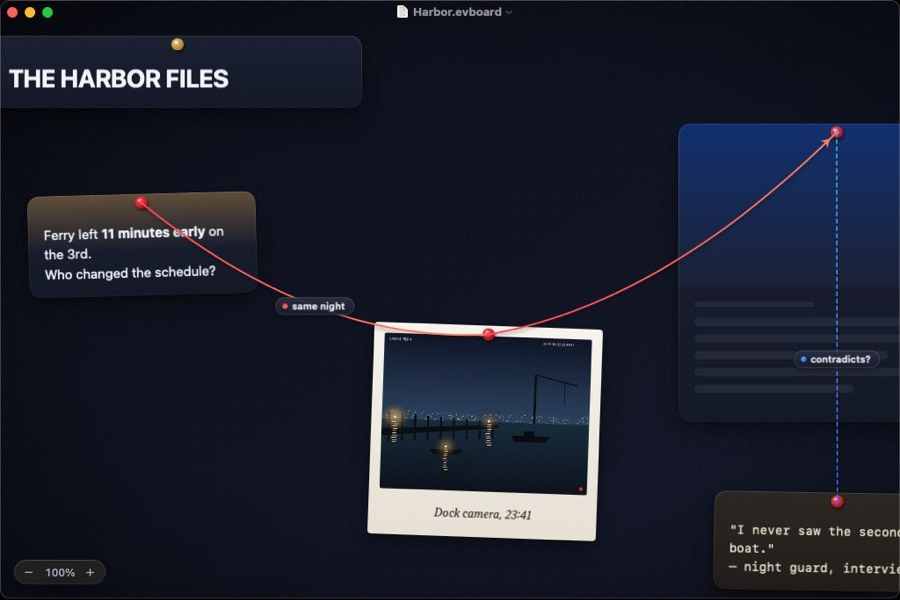

# Evidence Board

A native macOS app for building detective-style evidence boards. You place **text**, **images** and **webpages** on an infinite free canvas and connect the dots with red string. Each board is saved as a single, portable **JSON** file.

- 📐 **Full design document:** [`docs/DESIGN.md`](docs/DESIGN.md)
- 🧾 **File format schema:** [`docs/schema/evidenceboard.schema.json`](docs/schema/evidenceboard.schema.json)
- 🗂 **Sample board:** [`docs/examples/harbor-case.evboard`](docs/examples/harbor-case.evboard)



## Highlights

- A free, infinite canvas that stays at 120 fps (Core Animation engine, culling, level of detail)
- Only three card types: Text, Image and Web
- Rich, gradient-driven link previews built from each page's own color palette
- Physical-looking strings with sag, labels, and **Focus** and **Trace** modes to follow connections
- Four themes: Noir (default), Cork, Blueprint and Daylight, with Liquid Glass on macOS 26
- `.evboard` is plain JSON. Images and link snapshots are embedded, so a board opens offline exactly as you saved it

Built with Swift 6, SwiftUI, AppKit and Core Animation in Xcode, targeting macOS 15 and later.

## Build and run

Requires **Xcode 16 or later** on **macOS 15 or later**.

1. Open `EvidenceBoard.xcodeproj`.
2. Pick the **EvidenceBoard** scheme and press **⌘R**. It signs to run locally, so no developer team is needed.
3. Press **⌘U** to run the BoardKit and CanvasKit tests.

To try a full board, open `docs/examples/harbor-case.evboard` with **File ▸ Open**.

From the command line:

```sh
swift test --package-path Packages/BoardKit     # also runs on Linux
swift test --package-path Packages/CanvasKit
xcodebuild -project EvidenceBoard.xcodeproj -scheme EvidenceBoard build
```

### Without a Mac

GitHub Actions builds and tests everything on every push (`.github/workflows/ci.yml`). To see the running app, push a commit whose message contains `[snapshot]` (or run the **Snapshot** workflow by hand). It launches the app on a macOS runner with an empty board and the sample board, and publishes screenshots that `Tools/fetch-snapshots.py <commit-sha> <dir>` downloads.

## Project layout

```
EvidenceBoard.xcodeproj    App project (the EvidenceBoard folder is synced, so new files are picked up automatically)
EvidenceBoard/             App target: SwiftUI app, document, window, HUD, theme, assets
Config/                    Info.plist (document types) and sandbox entitlements
Packages/BoardKit/         Model, JSON codec, validation, BoardStore. Foundation only
Packages/CanvasKit/        Camera and the Core Animation canvas (AppKit)
docs/                      Design document, JSON schema, sample board
Tools/                     Helper scripts
```

## Status

**M0 (skeleton)**, **M1 (text cards)**, **M2 (image cards)** and **M3 (strings)** are done.

**Strings (M3)**
- **Connect:** hover a card and its pin brightens. Drag from the pin to another card: the string follows on a spring, snaps onto the target's pulsing pin, and pulls taut when you let go. Let go on empty canvas and it slides back into the pin. With the **Connect tool (C)** you can drag from anywhere on a card. **⌘K** connects two selected cards.
- **Edit:** click a string to select it, drag it up or down to change the slack, double-click (or **↩**) to label it, and **⌫** to delete it. Right-click for color, thickness, style, arrow, slack and direction. New strings use the last color, thickness and style you picked.
- **Look:** a gradient from pin to pin with a fiber texture, a soft shadow, knots over the pins, arrowheads and a glass label capsule. Further out they turn solid, then become hairlines. Several strings between the same two cards fan out.
- **Focus (F):** highlights the selected cards and everything one string away, and dims the rest. Press **F** again to widen by a hop.
- **Trace (⌘T):** with two cards selected, lights up the shortest chain of strings between them and sends a glow along it. **Esc** leaves Focus or Trace. Finding the path takes well under 5 ms on a 1,000-string board (there's a test for it).

**Images (M2)**
- **Add:** drop images or image files from Finder or a browser, paste them, or use **Insert ▸ Image…** (⌘⇧I). PDFs show their first page.
- **Frames:** Polaroid (the default), Photo or Borderless, from the right-click menu.
- **Captions:** double-click the caption area, or select the photo and press **↩**. Captions are set in New York italic, on the paper or over the photo.
- **Reframe:** double-click the photo, then drag to move it inside the frame and scroll or pinch to zoom. The rest of the picture shows faded around the card. **↩** keeps the change, **Esc** cancels. Nothing is ever cut from the stored image.
- **Resize:** photos keep their shape. Hold **⇧** to change it.
- **Storage:** images are capped at 4096 px, re-encoded only when needed, and stored once even if used many times. On screen they're decoded off the main thread at just the size needed, with a bounded memory cache. **Debug ▸ Add 200 Test Photos** fills a board for checking.

**Text (M1)**
- **Create:** double-click empty canvas, press **T**, use **Insert ▸ Text Card** (⌘⇧T), or paste text.
- **Edit:** double-click a card or press **↩**. **Esc** or **⌘↩** finishes. Markdown `**bold**`, `*italic*` and `` `code` `` render on the card.
- **Select, move, resize:** click, ⇧/⌘-click, marquee, ⌘A, drag, arrow keys, and corner handles.
- **Arrange:** front/back, lock, duplicate, copy, cut and paste between boards, plus style and color from the right-click menu. Every change is one undo step.

**Base (M0):** the document app (New, Open, Save, autosave, Versions), the forgiving JSON codec, the Noir canvas, and the camera.

Not verified yet: frame rate and memory on real hardware (they need a Mac and Instruments), how the string physics feel on a real trackpad, and the Trace glow moving along the path. The glow's position is tested, but CI screen captures never show it. Web cards still show placeholders until M4.

See the roadmap in [`docs/DESIGN.md` §16](docs/DESIGN.md#16-roadmap).
