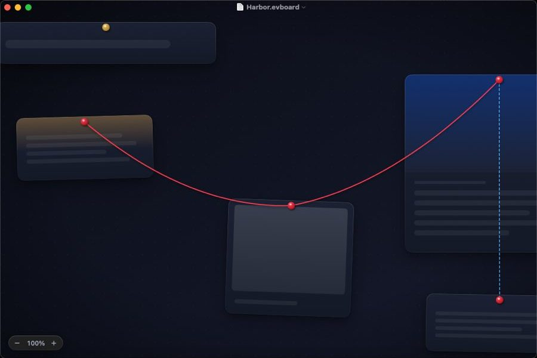

# Evidence Board

A native macOS app for building detective-style evidence boards. You place **text**, **images** and **webpages** on an infinite free canvas and connect the dots with red string. Each board is saved as a single, portable **JSON** file.

- 📐 **Full design document:** [`docs/DESIGN.md`](docs/DESIGN.md)
- 🧾 **File format schema:** [`docs/schema/evidenceboard.schema.json`](docs/schema/evidenceboard.schema.json)
- 🗂 **Sample board:** [`docs/examples/harbor-case.evboard`](docs/examples/harbor-case.evboard)



## Highlights

- A free, infinite canvas that stays at 120 fps (Core Animation engine, culling, level of detail)
- Only three card types: Text, Image and Web
- Rich, gradient-driven link previews built from each page's own color palette
- Physical-looking strings with sag, labels, and **Focus** and **Trace** modes to follow connections
- Four themes: Noir (default), Cork, Blueprint and Daylight, with Liquid Glass on macOS 26
- `.evboard` is plain JSON. Images and link snapshots are embedded, so a board opens offline exactly as you saved it

Built with Swift 6, SwiftUI, AppKit and Core Animation in Xcode, targeting macOS 15 and later.

## Build and run

Requires **Xcode 16 or later** on **macOS 15 or later**.

1. Open `EvidenceBoard.xcodeproj`.
2. Pick the **EvidenceBoard** scheme and press **⌘R**. It signs to run locally, so no developer team is needed.
3. Press **⌘U** to run the BoardKit and CanvasKit tests.

To try a full board, open `docs/examples/harbor-case.evboard` with **File ▸ Open**.

From the command line:

```sh
swift test --package-path Packages/BoardKit     # also runs on Linux
swift test --package-path Packages/CanvasKit
xcodebuild -project EvidenceBoard.xcodeproj -scheme EvidenceBoard build
```

### Without a Mac

GitHub Actions builds and tests everything on every push (`.github/workflows/ci.yml`). To see the running app, push a commit whose message contains `[snapshot]` (or run the **Snapshot** workflow by hand). It launches the app on a macOS runner with an empty board and the sample board, and publishes screenshots that `Tools/fetch-snapshots.py <commit-sha> <dir>` downloads.

## Project layout

```
EvidenceBoard.xcodeproj    App project (the EvidenceBoard folder is synced, so new files are picked up automatically)
EvidenceBoard/             App target: SwiftUI app, document, window, HUD, theme, assets
Config/                    Info.plist (document types) and sandbox entitlements
Packages/BoardKit/         Model, JSON codec, validation, BoardStore. Foundation only
Packages/CanvasKit/        Camera and the Core Animation canvas (AppKit)
docs/                      Design document, JSON schema, sample board
Tools/                     Helper scripts
```

## Status

**M0 (skeleton)** is in place:

- Document-based app (SwiftUI `DocumentGroup`) for `.evboard` files, with New, Open, Save, autosave and Versions. Opening is checked on a macOS runner. Saving uses the same codec, which is round-trip tested, but the save flow hasn't been clicked through yet.
- JSON codec v1. Loading is forgiving: bad cards and strings are skipped with a banner, and out-of-range values are clamped. Saving writes pretty-printed, sorted JSON and drops unused images.
- Noir canvas: background gradient, vignette and adaptive dot grid.
- Camera: trackpad pan, pinch zoom around the cursor, ⌘-scroll zoom, Space-drag and middle-drag panning, smart zoom, and animated zoom commands (⌘= ⌘− ⌘0 ⌘1) with a glass zoom HUD.
- Cards and strings from a loaded file are drawn as styled skeletons (real body, shadows, pins and sagging string). Real text, image and link rendering arrives with M1–M4.

See the roadmap in [`docs/DESIGN.md` §16](docs/DESIGN.md#16-roadmap).
