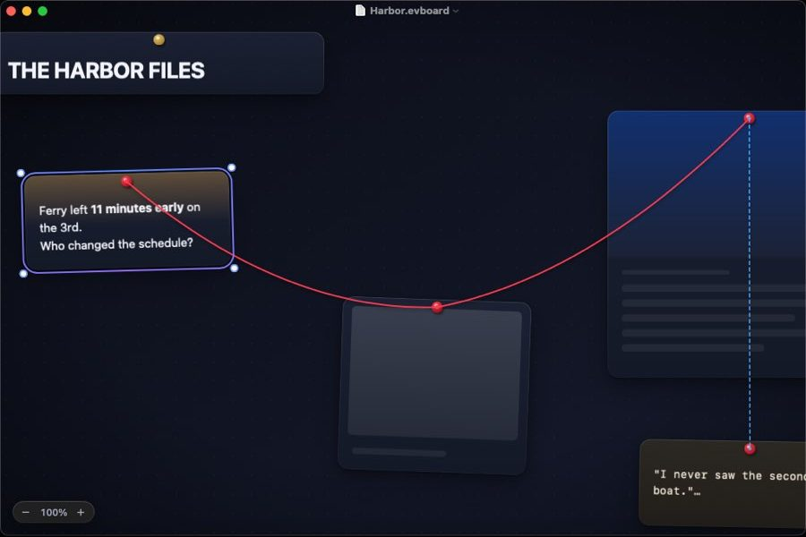

# Evidence Board

A native macOS app for building detective-style evidence boards. You place **text**, **images** and **webpages** on an infinite free canvas and connect the dots with red string. Each board is saved as a single, portable **JSON** file.

- 📐 **Full design document:** [`docs/DESIGN.md`](docs/DESIGN.md)
- 🧾 **File format schema:** [`docs/schema/evidenceboard.schema.json`](docs/schema/evidenceboard.schema.json)
- 🗂 **Sample board:** [`docs/examples/harbor-case.evboard`](docs/examples/harbor-case.evboard)



## Highlights

- A free, infinite canvas that stays at 120 fps (Core Animation engine, culling, level of detail)
- Only three card types: Text, Image and Web
- Rich, gradient-driven link previews built from each page's own color palette
- Physical-looking strings with sag, labels, and **Focus** and **Trace** modes to follow connections
- Four themes: Noir (default), Cork, Blueprint and Daylight, with Liquid Glass on macOS 26
- `.evboard` is plain JSON. Images and link snapshots are embedded, so a board opens offline exactly as you saved it

Built with Swift 6, SwiftUI, AppKit and Core Animation in Xcode, targeting macOS 15 and later.

## Build and run

Requires **Xcode 16 or later** on **macOS 15 or later**.

1. Open `EvidenceBoard.xcodeproj`.
2. Pick the **EvidenceBoard** scheme and press **⌘R**. It signs to run locally, so no developer team is needed.
3. Press **⌘U** to run the BoardKit and CanvasKit tests.

To try a full board, open `docs/examples/harbor-case.evboard` with **File ▸ Open**.

From the command line:

```sh
swift test --package-path Packages/BoardKit     # also runs on Linux
swift test --package-path Packages/CanvasKit
xcodebuild -project EvidenceBoard.xcodeproj -scheme EvidenceBoard build
```

### Without a Mac

GitHub Actions builds and tests everything on every push (`.github/workflows/ci.yml`). To see the running app, push a commit whose message contains `[snapshot]` (or run the **Snapshot** workflow by hand). It launches the app on a macOS runner with an empty board and the sample board, and publishes screenshots that `Tools/fetch-snapshots.py <commit-sha> <dir>` downloads.

## Project layout

```
EvidenceBoard.xcodeproj    App project (the EvidenceBoard folder is synced, so new files are picked up automatically)
EvidenceBoard/             App target: SwiftUI app, document, window, HUD, theme, assets
Config/                    Info.plist (document types) and sandbox entitlements
Packages/BoardKit/         Model, JSON codec, validation, BoardStore. Foundation only
Packages/CanvasKit/        Camera and the Core Animation canvas (AppKit)
docs/                      Design document, JSON schema, sample board
Tools/                     Helper scripts
```

## Status

**M0 (skeleton)** and **M1 (text cards)** are done. The board is a working text board:

- **Create:** double-click empty canvas, press **T**, use **Insert ▸ Text Card** (⌘⇧T), or paste plain text.
- **Edit:** double-click a card or press **↩**. The editor sits exactly over the card and shows the raw text, `**markdown**` included. Press **Esc** or **⌘↩** to finish. A new card left empty disappears.
- **Select:** click, ⇧/⌘-click, drag a marquee, or **⌘A**. One card gets a turning gradient ring and resize handles.
- **Move and resize:** drag cards (they lift while you drag), nudge with the arrow keys (⇧ for 10 pt), or drag a corner handle. Height follows the text until you change it by hand.
- **Arrange:** Bring to Front / Send to Back, Lock, Duplicate (⌘D), Delete, Cut, Copy and Paste between boards. Right-click a card for Style (Note, Headline, Typewriter) and Color.
- **Undo:** every change is one undo step and marks the document as edited.
- **Rendering:** text is drawn by TextKit into bitmaps per zoom tier, only for cards near the view and only a few per frame. Zoomed out, cards drop to simpler detail levels. **Debug ▸ Add 500 Test Cards** fills a board for performance checks.

From M0: the document app (New, Open, Save, autosave, Versions), the forgiving JSON codec, the Noir canvas, and the camera (trackpad pan, pinch and ⌘-scroll zoom, Space-drag, ⌘= ⌘− ⌘0 ⌘1).

Not verified yet: frame rate on real hardware (the 120 fps target for 500 cards needs a Mac and Instruments). Image and web cards still show placeholders until M2 and M4. Strings are drawn but can't be created until M3.

See the roadmap in [`docs/DESIGN.md` §16](docs/DESIGN.md#16-roadmap).
